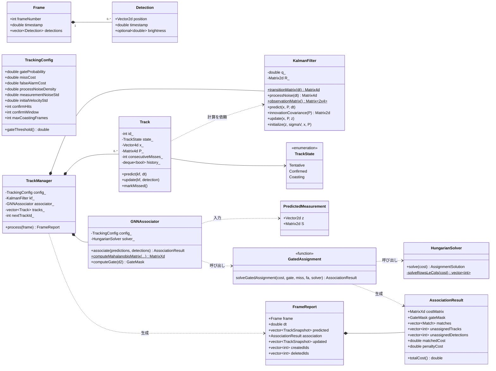
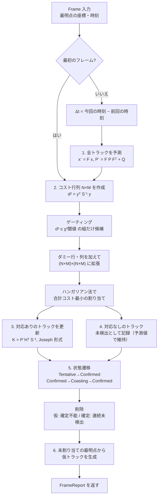
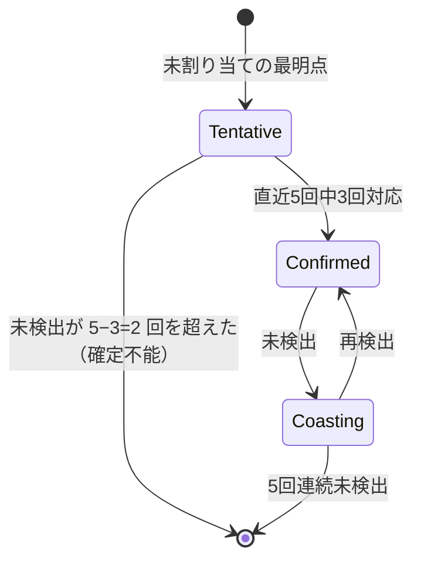
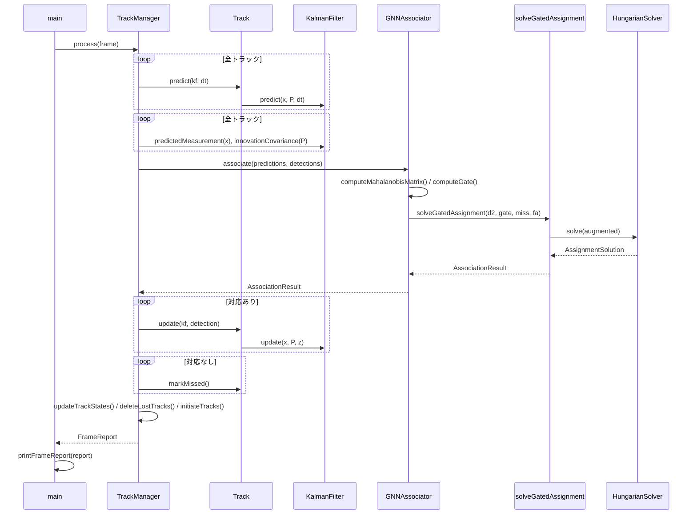

# 01. 全体設計と実装方針

## 1. 実装方針

| 方針 | 内容 |
|---|---|
| 段階的に作る | STEP 1（2フレーム間のGNN）→ STEP 2（トラック管理 + α-β推定）→ STEP 3（カルマンフィルタ + マハラノビス距離）の順に機能を足す。STEP ごとにフォルダーを分け、それぞれ単独でビルド・実行できる |
| 変わらない部分は共通化 | ハンガリアン法・ダミー拡張・入力データ型・疑似データ生成は全STEPで同じなので `common/` に置く |
| 変わる部分はSTEPごとに持つ | `TrackingConfig` / `GNNAssociator` / `Track` / `TrackManager` はSTEPごとに中身が変わる。各STEPのフォルダーにそれぞれ置き、**フォルダー同士の差分を見れば「何が追加されたか」が分かる**ようにした |
| アルゴリズムと入出力を分離 | `TrackManager` は画面に何も出さず、処理内容を `FrameReport` として返す。表示は `ReportPrinter` / `Printing` が担当する。これによりテストから処理結果を直接検証できる |
| 依存を一方向にする | `HungarianSolver` は GNN を知らない。`GNNAssociator` は `Track` もカルマンフィルタも知らない。`KalmanFilter` は対応回数などトラック管理の情報を持たない |
| 過度な抽象化をしない | 仮想関数・テンプレートによる戦略パターン等は使わない。STEP 2 と STEP 3 の違いはファイルを差し替えることで表現する |

## 2. ファイル構成

```
gnn/
├── CMakeLists.txt             … 全STEPのビルド定義（Visual Studio の「フォルダーを開く」でも使える）
├── README.md                  … 概要・ビルド方法・テスト結果
├── common/                    … 全STEP共通
│   ├── Detection.h            … Detection（最明点1点）, Frame（1フレームの入力）
│   ├── AssociationResult.h    … Match, AssociationResult（対応付け結果）, GateMask
│   ├── HungarianSolver.h/.cpp … ハンガリアン法（矩形行列・禁止要素対応）
│   ├── GatedAssignment.h/.cpp … ダミー行・列による未割り当て許容 + ハンガリアン法の呼び出し
│   ├── ScenarioGenerator.h/.cpp … 疑似データ生成（処理系に依存しない乱数）
│   ├── StandardScenarios.h    … STEP 2/3 共通のテストシナリオ
│   ├── IdConsistency.h        … 真値IDとトラックIDの対応評価（デモ・テスト専用）
│   ├── Printing.h/.cpp        … コンソール表示の補助（行列・ゲート・割り当て結果）
│   ├── TestFramework.h        … 標準ライブラリのみの最小テストマクロ
│   └── test_hungarian.cpp     … ハンガリアン法の単体テスト（全探索との比較）
├── step1_basic_gnn/           … STEP 1：基本的なGNN
│   ├── TrackingConfig.h       … ゲート半径・未検出コスト・未割り当て観測コスト
│   ├── GNNAssociator.h/.cpp   … ユークリッド距離・ゲーティング・割り当て
│   ├── main.cpp               … デモ（資料の例・貪欲法との比較・疑似データ）
│   └── test_step1.cpp
├── step2_multi_frame/         … STEP 2：複数フレームの継続追跡
│   ├── TrackingConfig.h       … + α, β, 確定・削除条件
│   ├── GNNAssociator.h/.cpp   … STEP 1 と同じ（基準点が「予測位置」になるだけ）
│   ├── Track.h/.cpp           … ID・位置・速度・状態・対応履歴（α-β フィルタ）
│   ├── TrackManager.h/.cpp    … 予測→対応付け→更新→状態遷移→削除→生成
│   ├── ReportPrinter.h/.cpp   … FrameReport の表示
│   ├── main.cpp               … デモ（引数でシナリオ選択）
│   └── test_step2.cpp
├── step3_kalman/              … STEP 3：カルマンフィルタを用いたGNN
│   ├── TrackingConfig.h       … + ゲート確率, q, σ_r, 初期速度σ
│   ├── KalmanFilter.h/.cpp    … F, Q, H, R, 予測, 更新（LLT + Joseph 形式）
│   ├── GNNAssociator.h/.cpp   … マハラノビス距離² + カイ二乗ゲート
│   ├── Track.h/.cpp           … 状態ベクトル x(4×1), 共分散 P(4×4)
│   ├── TrackManager.h/.cpp    … KalmanFilter を使うように変更
│   ├── ReportPrinter.h/.cpp   … + 位置σ, 残差σ の表示
│   ├── main.cpp
│   └── test_step3.cpp
└── docs/                      … 解説資料（このフォルダー）
```

## 3. クラスの責務と、指定された設計からの変更点

| クラス・構造体 | 責務 | 場所 |
|---|---|---|
| `Detection` | 最明点1点（座標・時刻・輝度）の保持 | common |
| `Frame` | 1フレーム分の最明点と時刻の保持【追加】 | common |
| `Track` | ID・位置・速度（STEP 3 は x, P）・追跡状態・対応履歴の保持 | step2, step3 |
| `KalmanFilter` | 状態予測・状態更新の計算（状態は持たない） | step3 |
| `GNNAssociator` | コスト行列生成・ゲーティング・対応付け | 各STEP |
| `solveGatedAssignment()` | ダミー行・列を加えた拡張行列の作成と解の分解【追加】 | common |
| `HungarianSolver` | 割り当て問題の求解（GNNとは無関係な純粋アルゴリズム） | common |
| `AssociationResult` | 対応付け結果（コスト行列・ゲート・組・未割り当て・合計コスト）の保持 | common |
| `TrackManager` | トラックの予測・生成・更新・確定・削除、1フレームの処理の統括 | step2, step3 |
| `FrameReport` / `TrackSnapshot` | 1フレームの処理内容の記録（表示・テスト用）【追加】 | step2, step3 |
| `TrackingConfig` | 閾値や追跡パラメータの管理 | 各STEP |
| `ScenarioGenerator` / `Rng` | 疑似データの生成【追加】 | common |

変更・追加した理由：

1. **`Frame` を追加** — 最明点の「個数・順序がフレームごとに変わる」入力を、時刻と一緒に1つの単位として扱うため。`TrackManager::process(const Frame&)` の引数になる。
2. **`solveGatedAssignment()` を `GNNAssociator` から切り出した** — ダミー行・列による未割り当て処理は、コストの種類（ユークリッド距離 / マハラノビス距離）に関係なく同じ。3つの STEP の `GNNAssociator` に同じコードを書かないように共通化した。クラスにする必要のある状態がないので関数にした。
3. **`FrameReport` を追加** — 課題の「フレームごとに予測位置・ゲート・コスト行列・…を出力」を、`TrackManager` に `std::cout` を書かずに実現するため。テストでも「フレーム7でトラックが Coasting か」などを直接確認できる。
4. **`KalmanFilter` は状態を持たない** — 資料（p.20）の `update()` は `++t.hits; t.misses = 0;` とトラック管理の処理まで行っているが、これはフィルタの責務ではない。カルマンフィルタは「(x, P) と観測から新しい (x, P) を計算する」だけにし、対応回数は `Track`、確定・削除の判断は `TrackManager` が行う。
5. **`HungarianSolver` は禁止要素を +∞ で受け取る** — 呼び出し側が「十分大きな値」を自分で選ぶ必要をなくすため。内部で、行列の値から必ず安全な有限値を計算して置き換える（[05_hungarian.md](05_hungarian.md)）。

## 4. クラス図

### STEP 3（最終形）



依存の向きに注目：`HungarianSolver` ← `GatedAssignment` ← `GNNAssociator` ← `TrackManager` と一方向で、
下位のクラスは上位のクラスを知らない。`GNNAssociator` は `Track` ではなく `PredictedMeasurement`（ẑ と S）だけを受け取るため、
カルマンフィルタ以外の推定方法と組み合わせることもできる。

### STEP ごとの違い

| クラス | STEP 1 | STEP 2 | STEP 3 |
|---|---|---|---|
| `GNNAssociator` の入力 | 前フレームの点の位置 | トラックの予測位置 | 予測観測 ẑ と残差共分散 S |
| コスト | ユークリッド距離 [px] | ユークリッド距離 [px] | マハラノビス距離² [無次元] |
| ゲート | 距離 ≤ 30 px | 距離 ≤ 30 px | d² ≤ χ²₂(P_G) |
| `Track` | なし | 位置・速度（α-β） | x (4×1), P (4×4) |
| `KalmanFilter` | なし | なし | あり |
| `TrackManager` | なし | あり | あり（KalmanFilter を使用） |

## 5. 処理フロー（1フレーム）



### トラックの状態遷移



> 資料（p.10）と HTML のライフサイクル図には「仮トラックの削除」がない。誤検出から作られた仮トラックを
> 消さないとトラックが増え続けるため、この経路を追加した。

## 6. クラス間の呼び出し順序（STEP 3）



`deleteLostTracks()` を対応付け結果を使う処理（更新・未検出の記録）の**後**に呼んでいるのは、
`AssociationResult` の `trackIndex` が `tracks_` の添字を指しているためである。先に削除すると添字がずれる。
